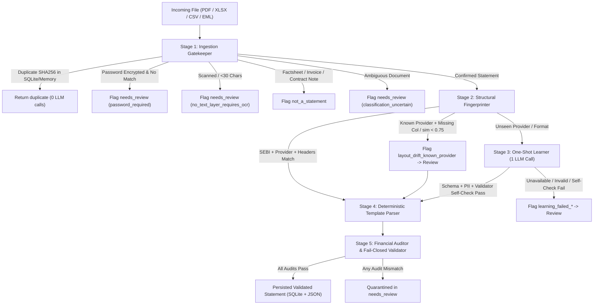

# Activv Money — Self-Learning PMS/AIF Statement Parser
## Architecture & Technical Design Document

---

## 1. Executive Summary & Design Philosophy

Financial wealth managers, family offices, and multi-asset platforms in India face a persistent operational bottleneck: parsing monthly and quarterly Portfolio Management Services (PMS) and Alternative Investment Funds (AIF) statements. Unlike mutual funds (which follow standardized CAS formats from CAMS/KFintech), PMS and AIF providers issue bespoke, unstandardized statements:
- Formats range from ruled tables and horizontal ledger lines to monospace plaintext flows, sectioned CSVs, and multi-sheet Excel files.
- Terminology varies across custodians: *Additions* vs. *Funds In* vs. *Drawdowns* vs. *Fresh Inflows*.
- Providers frequently alter layouts without prior notification (**Layout Drift**).

### The Self-Learning Paradigm
This engine implements a **"Learn Once, Parse Infinitely"** architecture:
$$\text{LLM Calls}(N) = 1 \quad \text{for document } 1, \quad 0 \quad \text{for documents } 2 \dots N$$
1. **First Encounter:** When a new statement format is first encountered, `FormatLearner` (`learner.py`) extracts and PII-redacts the document text, attaches the `FormatTemplate` JSON Schema and a worked example, and makes **1 LLM call** to synthesize a declarative `FormatTemplate` (`templates/<format_id>.json`).
2. **Schema, PII & Self-Check Guardrails:** The candidate template is validated against `FormatTemplate` (Pydantic V2), scanned for PII leaks, executed deterministically by `StatementParser` on the sample document, and audited by `FinancialValidator`. Only if zero critical issues remain is the template persisted to disk.
3. **Subsequent Statements:** Every future statement matching that structural fingerprint is parsed **100% deterministically** using the template's mappings and regexes with **0 LLM calls**.
4. **Layout Drift & Provider Identity Protection:** If a known provider renames a mapped column or alters table headers ($\text{similarity} < 0.75$), or if a different provider shares a similar table structure, the engine refuses silent misattribution and routes drifted layouts to `needs_review`.

---

## 2. End-to-End Pipeline Architecture

### Stage 1: Ingestion Gatekeeper (`ingestion.py`)
- **Persistent SHA-256 Deduplication:** Computes the SHA-256 hash of every incoming file (after decrypting if encrypted). Checked against both in-memory state and SQLite (`persistence.py`) before parsing.
- **Password Decryption & Temp Cleanup:** Detects encrypted PDFs via `pypdf.PdfReader.is_encrypted`, tries candidate passwords from `STATEMENT_PASSWORDS`, writes a temporary decrypted PDF for downstream parsing, and deletes the temporary file in a `finally` block.
- **Scanned Document Detection:** Flags PDFs with `<30` extractable characters as `no_text_layer_requires_ocr`.
- **Three-Way Document Classifier:** Returns `"statement"`, `"not_a_statement"`, or `"ambiguous"` (`needs_review` with `classification_uncertain`). Never silently drops a document containing valid ISINs and a holdings/valuation table.
- **Collision-Free Email Unbundling:** Sanitizes attachment filenames with `os.path.basename` and prefixes saved files with `{msg_prefix}_{part_idx}_{safe_name}`.

### Stage 2: Structural Fingerprinter (`fingerprinter.py`)
- Extracts `sebi_regn` (`INP\d+`, `IN/AIF...`), `doc_provider` (normalized top title line), `layout_kind`, and `table_headers`.
- **Strict Identity Matching:** Rejects any candidate template whose `sebi_regn` conflicts with the document's SEBI number or whose `fields.provider` has `<0.75` similarity with `doc_provider`.
- **Granular Column Drift Detection:** Checks both overall header similarity ($\ge 0.75$) and whether every column in `template.holdings.mapping` and `template.summary.mapping` is present in the document's table headers.

### Stage 3: Real One-Shot Format Learner (`learner.py`)
- **PII Redaction (`extract_and_redact_document_text`):** Extracts text from the first pages/sheets and masks PANs (`<REDACTED_PAN>`), client names (`<REDACTED_NAME>`), emails, phone numbers, and formatted currency amounts (`<AMOUNT>`).
- **Prompt Construction (`build_learning_prompt`):** Combines structural features, PII-redacted text, the full `FormatTemplate.model_json_schema()`, and `WORKED_EXAMPLE_TEMPLATE`, instructing Google Gemini (`gemini-3.8-flash` with primary `GEMINI_API_KEY` and fallback `GEMINI_BACKUP_API_KEY`) to return JSON only.
- **Three-Stage Verification:**
  1. `validate_template_schema_and_pii()`: Validates against `FormatTemplate` and scans for leaked PII patterns (`learning_failed_invalid_template`).
  2. Deterministic parse of the sample document via `StatementParser`.
  3. Audit via `FinancialValidator`: requires zero critical issues (`learning_failed_self_check`).

### Stage 4: Template-Driven Deterministic Parser (`parser.py`)
Every parser branch (`_parse_ruled_table`, `_parse_monospace_text`, `_parse_ruled_lines`, `_parse_xlsx`, `_parse_csv_sectioned`) reads its configuration declaratively from the `FormatTemplate`:
- **Declarative Row Labels:** Key summary and table row identifiers (`cash_row_labels`, `total_row_labels`, `nav_row_labels`, `gross_long_labels`, `gross_short_labels`) are declared in `template.holdings`. The parser checks these template labels first to classify cash, subtotal, and closing balance rows. If a template omits them, the parser falls back to standard accounting defaults and records a non-blocking diagnostic notice (`template_missing_row_labels`).
- **Section Headers & Column Mappings:** Reads section headers, end markers, column mappings, summary field order, holding regexes, transaction regexes, and transaction `type_map` directly from the template.

### Stage 5: Financial Auditor & Validator (`validator.py`)
Executes 16 deterministic checks under a strict **Fail-Closed** policy:
- Document completeness (`incomplete_document_missing_continuation_page`)
- Provider vs. template identity (`provider_mismatch_template`)
- Missing mapped columns (`expected_column_missing:<col>`)
- Required metadata & non-zero balances (`missing_required_metadata`, `empty_statement_zero_balances`)
- Holdings sum vs. stated Total Equity (`holdings_sum_ne_stated_total_equity`)
- Holdings + Cash vs. Closing NAV (`closing_value_ne_holdings_total`)
- Summary table cash vs. holdings row cash (`cash_summary_vs_row_mismatch`)
- Summary roll-forward: $\text{Opening} + \text{Inflow} - \text{Outflow} + \text{Gain} - \text{Fee} = \text{Closing}$ within ₹1.00 (`summary_rollforward_mismatch`)
- Per-holding $\text{Quantity} \times \text{Price} = \text{Market Value}$ within 0.5% (`holding_qty_price_mismatch`)
- Holding weights sum to $100\% \pm 0.5\%$ (or 3%) (`holdings_weight_sum_invalid`)
- Long-only template negative quantity check (`negative_quantity_in_long_only_template`)
- Reporting period range bounds: `period_start <= period_end` (`invalid_period_range`)
- ISO 6166 Mod-10 Luhn ISIN check digit (`invalid_isin_checksum`) and duplicate ISIN check (`duplicate_holding_isin`)
- Unmapped transaction types (`unmapped_transaction_type`) and transaction date bounds (`transaction_date_outside_period`)

---

## 3. Answers to the Four Hard Questions

### Question 1: What exactly does the LLM produce when it "learns" a format, and how do you make sure a bad template never silently corrupts downstream data?
1. **What the LLM produces:** The LLM produces a strictly typed `FormatTemplate` JSON object (validated by Pydantic in `models.py`) — **never executable Python code** and **never extracted client numbers**. Specifically, it outputs:
   - `layout_kind` (`ruled_table`, `monospace_text`, `ruled_lines_horizontal_only`, `xlsx`, `csv_sectioned`)
   - `fingerprint` (expected summary, holdings, and transaction column headers)
   - `fields` & `period` (regex patterns with capture groups for `client_id`, `client_name`, `pan`, `strategy`, and statement dates)
   - `summary`, `holdings`, and `transactions` configurations (column header mappings, section headers/end markers, line regexes, `type_map` dictionary, and boolean flags `has_gain`, `supports_short`, `is_unlisted`).
2. **How bad templates are blocked from corrupting data:**
   - **Gate 1 (Schema & PII Gate):** `validate_template_schema_and_pii()` validates the JSON against `FormatTemplate` and rejects any template containing PANs, ISINs, emails, phone numbers, or sample client names (`learning_failed_invalid_template`).
   - **Gate 2 (Deterministic Self-Check):** The candidate template is immediately run through `StatementParser.parse()` on the sample document and audited by `FinancialValidator.validate()`. If the parsed output has zero holdings, missing metadata, a roll-forward mismatch, a holdings-plus-cash vs. closing mismatch, an unmapped transaction type, or any other critical issue, the template is **discarded in memory**, never written to `templates/`, and the document is quarantined to `needs_review` with `learning_failed_self_check`.

### Question 2: How do you distinguish a genuinely new format from a known provider that slightly changed its layout (layout drift), and from a non-statement document (factsheet, invoice, contract note)?
1. **Non-Statement vs. Statement (Stage 1 — `IngestionEngine.classify_document`):**
   - Before fingerprinting, the three-way classifier checks for explicit non-statement titles (`MONTHLY FUND FACTSHEET`, `TAX INVOICE`, `CONTRACT NOTE`) and verifies whether the document contains portfolio holdings/ISINs. Confirmed non-statements return `not_a_statement`; documents with client + period + portfolio pillars (or ISINs + holdings table) proceed as `statement`; uncertain prose documents fail closed to `needs_review` (`classification_uncertain`).
2. **Known Provider Layout Drift vs. Genuinely New Format (Stage 2 — `FormatFingerprinter.match_template`):**
   - **Provider Identity First:** We extract the document's SEBI registration number (`INP...` / `IN/AIF...`) and top organization header (`doc_provider`).
   - **Known Provider + Changed Structure = Layout Drift:** If a document's SEBI registration or provider name matches an existing template (similarity $\ge 0.80$ and no SEBI conflict), it belongs to that known provider. We then check whether (a) overall table header similarity is $\ge 0.75$ and (b) every column required by `template.holdings.mapping` and `template.summary.mapping` exists in the document's tables. If a column was renamed (e.g., `"Market Value"` $\rightarrow$ `"Mkt Val"`) or reordered ($\text{similarity} < 0.75$), it is flagged as `layout_drift_known_provider` (plus `expected_column_missing:<col>`) and held in `needs_review`.
   - **Unmatched Provider / SEBI = New Format:** If the SEBI registration or provider name does not match any registered template (e.g., `"Zenith Wealth PMS"` or `"Meridian Wealth PMS"`), `match_template` returns `(None, None, False)` even if the table headers look similar, routing the file to `FormatLearner` as a genuinely new provider format.

### Question 3: How do you handle duplicate files vs. revised statements for the same client and period, including across process restarts?
1. **Hard Duplicates (Byte-Identical Content):**
   - `IngestionEngine` computes the SHA-256 hash of the file content (after decrypting if password-protected).
   - Every processed statement's `sha256_hash` is persisted in the SQLite `statements` table (`persistence.py`). On startup (and before each email in `watch_mailbox.py`), `StatementStore.sync_to_pipeline()` loads all historical hashes into `pipeline.ingestion.seen_hashes`.
   - If an incoming file's SHA-256 matches an existing hash, the pipeline halts before parsing and returns `status="duplicate"`, `issues=["identical_to:<original_file>"]` with 0 LLM calls.
2. **Soft Revisions (Same Provider, Client, and Period End, Different Content):**
   - `StatementStore.sync_to_pipeline()` also reconstructs `seen_statements` keyed by `(provider.lower(), client_id.upper(), period_end)` from SQLite.
   - After parsing a statement, `register_or_check_revision()` checks whether `(provider, client_id, period_end)` was already seen with a different `sha256_hash` (excluding same-data cross-format exports such as `.xlsx` vs `.csv` with identical financial payloads). When a revised PDF arrives for an existing period, it is quarantined to `needs_review` with `issues=["revision_of_existing_statement"]` so an analyst can confirm whether to supersede the prior record.

### Question 4: When consolidating a client's portfolio across multiple PMS and AIF providers, what can go wrong and how does your consolidator prevent bad numbers?
1. **Unvalidated or Drifted Statements:** Blending numbers from a broken or drifted statement corrupts the client's net worth. `PortfolioConsolidator` (`consolidator.py`) strictly accepts only `status == "validated"` statements and logs any rejected statement in `excluded_statements` with its rejection reason.
2. **Cross-Currency Contamination (INR vs. USD):** Summing USD (e.g., Fulcrum F2 in USD) and INR corpus values produces meaningless totals. `consolidate_all_currencies()` segregates consolidated views by ISO currency code (`INR` vs. `USD`) and never adds cross-currency numbers without an explicit FX rate.
3. **Different Printed Names for the Same Security Across Custodians:** One PMS may print `"Kotak Mahindra Bank Ltd"` while another prints `"Kotak Mahindra Bank Limited"`. Grouping by string name duplicates the holding. Our consolidator joins listed equities strictly by **normalized 12-character ISIN** (`INE237A01028`), summing quantities, total cost, and market value, and recomputing weighted-average price and portfolio weight.
4. **Unlisted AIFs Without ISINs:** Category II AIF holdings (e.g., Evergreen Alternatives) hold unlisted private companies without ISINs. Rather than dropping them or colliding on `isin=None`, the consolidator routes `is_unlisted` / non-ISIN AIF positions into a dedicated `unlisted_aif_holdings` bucket.
5. **Multiple Strategies Under the Same Provider:** A client may hold two different PMS strategies with the same wealth manager. Keying accounts by `(provider, client_id)` rather than `provider` alone prevents one account from overwriting the other.

---

## 4. Core Architecture Brief Q&A (Verbatim)

### 1. How a statement is recognised as a known format
`FormatFingerprinter` (`fingerprinter.py`) extracts invariant structural features without reading client data: SEBI registration number (`INP...`, `IN/AIF...`), top organization title / provider key, layout canvas geometry (`ruled_table`, `monospace_text`, `ruled_lines_horizontal_only`, `xlsx`, `csv_sectioned`), and table/section headers. A statement matches a known template if: (a) SEBI registration numbers match or do not conflict, (b) provider identity string similarity $\ge 0.75$, (c) overall table header token similarity $\ge 0.75$, and (d) all mapped holdings and summary columns exist in the document's tables.

### 2. What exactly is stored when a format is learned and why that representation
The learner stores a declarative `FormatTemplate` JSON object in `templates/<format_id>.json` conforming to a Pydantic schema (`models.py`). It stores: `layout_kind`, fingerprint tokens (table/summary/holdings/transactions headers), field regex patterns (client ID, PAN, strategy, period), summary mapping & roll-forward flags, holdings column mapping & row classification labels (`cash_row_labels`, `total_row_labels`), and transaction mapping & `type_map`.
*Why this representation:* Declarative JSON is human-auditable, version-controllable, strictly typed, and completely separates extraction configuration from code execution. It eliminates code injection risks (unlike storing executable Python scripts) and guarantees that zero client PII or monetary values are ever stored.

### 3. How a deterministic parse is checked as correct without an AI
`FinancialValidator` (`validator.py`) audits the parsed statement records against 16 mathematical, accounting, and regulatory invariant checks under a fail-closed policy:
- **Summary Roll-forward:** $\text{Opening} + \text{Inflow} - \text{Outflow} + \text{Gain} - \text{Fee} = \text{Closing} \pm ₹1.00$.
- **Holdings Reconciliation:** $\sum \text{Holding MV} + \text{Cash} = \text{Closing Corpus} \pm ₹1.00$ and holdings sum equals stated Total Equity.
- **Per-holding Math:** $\text{Quantity} \times \text{Price} = \text{Market Value} \pm 0.5\%$.
- **Holding Weight Bounds:** total weights sum to $100\% \pm 0.5\%$, each holding weight matches $\text{MV} / \text{Total} \pm 0.1$.
- **ISIN Integrity:** Mod-10 Luhn check digit verification on all 12-character ISINs.
- **Business Rules:** Long-only non-negative quantity assertions, date chronological bounds (`period_start <= period_end`), and metadata sanity (single line $\le 80$ chars, no amount patterns).

### 4. What happens when a known provider quietly changes its layout
When a known provider modifies its layout, `FormatFingerprinter` identifies the provider via SEBI registration or provider title match, but detects structural divergence: table header similarity $< 0.75$ or a mapped column missing from the document's tables. The system refuses to silently misparse or guess column mappings. It immediately flags the statement with `layout_drift_known_provider` (and `expected_column_missing:<col>`) and quarantines the document in `needs_review`. If a versioned template (`<provider>_v2.json`) already exists, it is used; otherwise, the one-shot learner can safely learn the v2 layout once verified through strict self-check gates.

