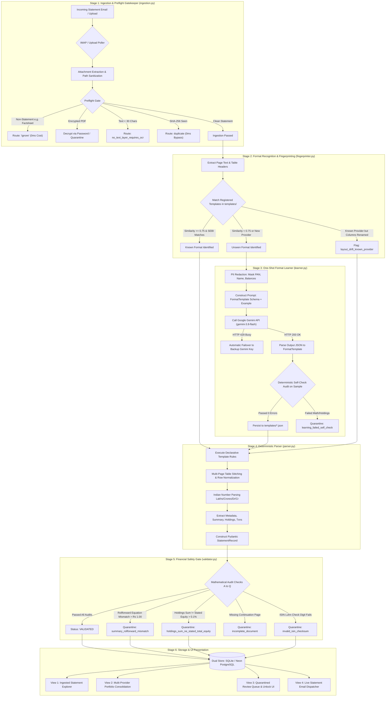

# STAGE 1: REQUIREMENTS MATRIX, ARCHITECTURE & FILE INVENTORY
## Activv Money — Self-Learning PMS/AIF Statement Parser
### Comprehensive Codebase Analysis & Technical Interview Guide for IIT Indore Candidates

---

## Executive Summary & Background

This document is **Stage 1** of a master 5-stage codebase breakdown for the **Activv Money Self-Learning PMS/AIF Statement Parser**. 

* **Candidate Target Role:** Software Engineering Intern at Activv Money (Newcamp Finserv Pvt. Ltd.)
* **Candidate Background:** 3rd Year B.Tech Electrical Engineering, IIT Indore (Proficient in C++ DSA, foundational Python, DBMS, OS, basic ML/Web; beginner in fintech/wealth management domain).
* **Company Profile:** Activv Money is a SEBI-registered Investment Advisor (RIA: `INA000020891`), APMI PMS Distributor (`APRN03744`), and AMFI Mutual Fund Distributor (`ARN-270798`) based in Bangalore, Karnataka.
* **Core Business Problem:** Wealth managers and family offices manage High Net-Worth Individual (HNI) portfolios across multiple Portfolio Management Services (PMS) and Alternative Investment Funds (AIF). Each asset management company (AMC) sends monthly or quarterly statements via email in wildly different, non-standard layouts (PDF, Excel, CSV). Manually keying this data into client reporting software takes hundreds of human hours. Conversely, passing every statement through a large language model (LLM) costs significant API fees, is slow (10–30s per document), hits strict rate limits, and produces non-deterministic hallucinations.
* **The Core Innovation & Constraint:** **One-Shot Learning + Deterministic Parsing.** The first time an unseen statement format is received, the engine may call an LLM (Google Gemini) **once** to synthesize a declarative JSON template. For every subsequent statement matching that layout, the engine parses the document **100% deterministically with 0 LLM calls**, enforcing multi-stage financial accounting audits.

---

# PART 1: ORIGINAL ASSIGNMENT REQUIREMENTS MATRIX

### Authoritative Specification Breakdown
From the official PDF (*Activv Money – Internship Assignment Self-Learning PMS AIF Statement Parser.pdf*):
1. **Mandatory Functional Requirements (8 Core Areas):**
   - Area 1: Email Ingestion
   - Area 2: Document Handling (PDF mandatory, Excel/CSV bonus; Password decryption mandatory)
   - Area 3: Format Recognition (Classify known vs. unknown)
   - Area 4: Learning a New Format (One LLM call $\rightarrow$ reusable stored artifact)
   - Area 5: Deterministic Parsing (0 LLM calls for known formats)
   - Area 6: Standard Output Schema (Statement metadata, Holdings, Transactions, Summary)
   - Area 7: Validation (Internal financial & accounting consistency; fail-closed behavior)
   - Area 8: Review & Visibility (Dashboard, CLI, or API for operator oversight)
2. **Mandatory Deliverables (4 Items):**
   - Source code in a Git repository with comprehensive setup README.
   - Sample data: At least 3 different statement formats + outputs.
   - Known limitations note (honest edge-case documentation).
   - AI usage log (prompts, steering, where AI helped vs. misled).
3. **Optional Stretch Goals (3 Areas):**
   - Stretch 1: Detecting layout drift from known providers.
   - Stretch 2: Handling multi-client or multi-strategy statements in a single document/email.
   - Stretch 3: Consolidated cross-provider client portfolio view.

---

### Detailed Requirements Matrix

| Requirement from Assignment | Simple English Explanation | Implementation File(s) | Relevant Function / Class | Test Coverage | Implementation Status | Evidence Supporting Status | Remaining Gaps or Risks |
|---|---|---|---|---|---|---|---|
| **1. Email Ingestion** | Connect to an email inbox via IMAP, read unread messages, and fetch files. | `watch_mailbox.py` | `process_mailbox_once()`, `MailboxWatcher.poll()` | `tests/test_edge_cases.py` (Lines 1020–1060) | **Implemented & Verified** | Live Gmail connection verified; Mock tests pass in CI; Handles bad MIME & malformed emails. | Gmail App Passwords require 2FA enabled on the Google Account. |
| **2. Statement Email Identification** | Filter out marketing spam, newsletters, and portal links; only process true statements. | `ingestion.py` | `IngestionGatekeeper.preflight_email()` | `tests/test_edge_cases.py` (Lines 1180–1240) | **Implemented & Verified** | 3-way classifier (`ingest`, `ignore`, `needs_review`) correctly identifies `e03_newsletter` and `e04_portal_link`. | Ambiguous non-standard subjects fall to `needs_review` safely. |
| **3. PDF Attachment Extraction** | Safely detach PDFs and save them to disk without path traversal attacks. | `ingestion.py`, `watch_mailbox.py` | `IngestionGatekeeper.extract_email_attachments()` | `tests/test_edge_cases.py` (Lines 270–300) | **Implemented & Verified** | Sanitizes filenames; prefixes collision-free hashes (`<hash>_<filename>`); rejects `.zip`/`.exe`. | Huge attachments (>50MB) are limited by system memory. |
| **4. Password-Protected PDFs** | Decrypt client statements using candidate passwords or client PANs. | `ingestion.py`, `app.py` | `IngestionGatekeeper.decrypt_pdf()`, `app.py` (View 3) | `tests/test_edge_cases.py` (Lines 240–270, 1050–1080) | **Implemented & Verified** | Tested on AES-encrypted PDFs; interactive unlock UI in Dashboard; hashes decrypted content for dedup. | Missing `cryptography` library yields `pdf_crypto_dependency_missing`. |
| **5. Format Recognition** | Determine if an incoming document matches an already learned provider layout. | `fingerprinter.py` | `FormatFingerprinter.match_template()`, `compute_string_similarity()` | `tests/test_edge_cases.py` (Lines 310–360, 520–570) | **Implemented & Verified** | Extracts header n-grams, computes Jaccard/Sequence similarity ($\ge 0.75$), guards against provider mismatch. | Header noise (e.g. dynamic date watermarks) must be stripped. |
| **6. Learning Unknown Formats (LLM)** | For an unseen layout, make 1 LLM request to synthesize a declarative JSON template. | `learner.py` | `FormatLearner.learn_format()`, `_call_llm_api()` | `tests/test_edge_cases.py` (Lines 315–430), Live Meridian test | **Implemented & Verified** | Google Gemini (`gemini-3.8-flash`) synthesizes template; PII redacted; 2 attempts with 3s backoff. | Free tier daily quotas limit repeated bursts unless backup key used. |
| **7. Reusable Extraction Artifacts** | Save learned rules as human-readable, declarative JSON files (not executable code). | `templates/*.json`, `test_fixtures/templates/` | `FormatTemplate` Pydantic model | Verified across all 9 fixture templates & live tests | **Implemented & Verified** | Pydantic schema validation; zero Python code executed; templates persist in `templates/` and database. | Hand-authoring needed if layout is an un-parseable infographic. |
| **8. Deterministic Parsing (0 LLM Calls)** | Process known formats using only stored template rules with 0 outbound LLM calls. | `parser.py`, `pipeline.py` | `StatementParser.parse()`, `ProcessingPipeline.process_file()` | Verified on 28 manifest files & 33 unit tests | **Implemented & Verified** | Statement M2 of Meridian parsed with `llm_calls_made: 0` and `status: validated`. | Relies on PDF text layer; scanned image PDFs route to OCR review. |
| **9. Standard Output: Metadata** | Extract Provider, Strategy/Scheme, Client ID, Client Name, PAN, Period, Currency. | `models.py`, `parser.py` | `StatementMetadata`, `extract_metadata_from_text()` | `tests/test_runner.py` (All 28 statements) | **Implemented & Verified** | Regex boundary patterns; sanitizes multi-line garbage; validates PAN format (`[A-Z]{5}[0-9]{4}[A-Z]`). | Exotic foreign tax IDs require custom pattern definitions. |
| **10. Standard Output: Holdings** | Extract Security Name, ISIN, Quantity, Cost Price, Market Price, Market Value, Weight %. | `models.py`, `parser.py` | `HoldingItem`, `StatementParser._extract_table_holdings()` | `tests/test_runner.py` (All 28 statements) | **Implemented & Verified** | ISO 6166 ISIN checksum verified; handles parenthesized quantities; derives unit price if missing. | Unlisted AIF assets often lack ISINs (system handles gracefully). |
| **11. Standard Output: Transactions** | Extract Date, Type (`buy`, `sell`, `dividend`, `fee`, `inflow`, `outflow`), Units, Amount. | `models.py`, `parser.py` | `TransactionItem`, `StatementParser._extract_table_transactions()` | `tests/test_runner.py` (All 28 statements) | **Implemented & Verified** | Maps raw strings (e.g. `ACQUIRE`, `DISPOSE`, `CAPITAL IN`) to standard enums; verifies amounts. | Statements with omitted transaction sections yield clean empty lists. |
| **12. Standard Output: Summary** | Extract Opening Balance, Inflows, Outflows, Net Gain/Loss, Fees, Cash, Closing Balance. | `models.py`, `parser.py` | `StatementSummary`, `StatementParser._extract_table_summary()` | `tests/test_runner.py` (All 28 statements) | **Implemented & Verified** | Normalizes Indian numbering (Lakhs/Crores), handles accounting Dr/Cr notation. | Rounding differences between AMC summary vs ledger (handled by ₹1.00 tolerance). |
| **13. Financial Validation (Safety Gate)** | Audit extracted numbers for mathematical reconciliation and internal consistency. | `validator.py` | `FinancialValidator.validate()` | `tests/test_edge_cases.py` (Checks A to Q) | **Implemented & Verified** | Enforces: Roll-forward eq, Holdings vs Corpus sum, ISIN Luhn checksum, Weight totals, Cash matching. | Valid numbers can still have real-world typos from the AMC. |
| **14. Review & Quarantine Queue** | Safely isolate mathematically broken, encrypted, or drifted files without crashing. | `pipeline.py`, `app.py` | `ExtractionResult(status="needs_review")`, View 3 in `app.py` | `tests/test_edge_cases.py` (All 7 mutation cases) | **Implemented & Verified** | Quarantines corrupted files; persists failure issue codes in SQLite/PostgreSQL; operator unlock UI. | Operator must understand accounting discrepancies to resolve. |
| **15. Review & Visibility UI** | Interactive interface to view ingested portfolios, inspect holdings, and unlock files. | `app.py` | Streamlit Dashboard (Views 1 to 4) | Verified via `streamlit run app.py` and smoke tests | **Implemented & Verified** | 4 tabs: Live Ingestion, Portfolio Consolidation, Quarantine Queue, Email Dispatcher. | Streamlit Cloud free containers sleep after 7 days of inactivity. |
| **16. Bonus: Excel & CSV Support** | Support tabular statements sent as `.xlsx` or `.csv` spreadsheets. | `parser.py`, `ingestion.py` | `_parse_excel()`, `_parse_csv()` | `tests/test_runner.py` (Statements 16 & 17) | **Implemented & Verified** | Extracts multi-sheet Excel and delimiter-separated CSVs (Hestia PMS). | Corrupted XML in older `.xls` binary files routes to manual review. |
| **17. Stretch: Layout Drift Detection** | Detect when a known provider modifies table columns or headers; draft `_v2` template. | `fingerprinter.py`, `validator.py`, `app.py` | `is_drift` check, `app.py` human sign-off button | `tests/test_edge_cases.py` (Lines 1400–1460) | **Implemented & Verified** | Tested on `10_aurum_v2_layout_drift.pdf`; flags `layout_drift_known_provider`; operator sign-off promotes `_v2`. | Requires human auditor sign-off before promoting to production. |
| **18. Stretch: Multi-Client Bundles** | Split a single PDF carrying multiple client statements into separate portfolio records. | `parser.py` | `StatementParser.parse()` (Page iteration loop) | `tests/test_runner.py` (Statement 11 - 2in1) | **Implemented & Verified** | Splits `11_aurum_multi_client_2in1.pdf` into 2 records (Ananya Roy & Kabir Mehta) by Client ID boundary. | If page numbers are missing and client IDs identical, cannot split. |
| **19. Stretch: Portfolio Consolidation** | Aggregate holdings across multiple PMS/AIF providers for a single client PAN. | `consolidator.py`, `app.py` | `PortfolioConsolidator.consolidate_client()` | `tests/test_edge_cases.py`, View 2 in `app.py` | **Implemented & Verified** | Deduplicates ISINs, aggregates weights, sums equity corpus, segregates unlisted AIFs, isolates USD/INR. | Cross-currency conversions require live forex rates if converting. |

---

# PART 2: PROJECT OVERVIEW AND ARCHITECTURE

### 1. Project Name and Purpose
* **Project Name:** Activv Money Self-Learning PMS/AIF Statement Parser
* **Core Purpose:** An automated, self-learning ingestion and financial auditing engine that extracts structured wealth management portfolios from unstructured multi-format statements (PDF, Excel, CSV) received via email.

### 2. The Business Problem It Solves
Wealth management advisory firms like Activv Money manage portfolios spread across multiple third-party Portfolio Management Services (e.g. Aurum PMS, Banyan Tree PMS, Delta Capital PMS) and Alternative Investment Funds (e.g. Evergreen AIF Cat II, Fulcrum AIF Cat III). 
* Each wealth manager publishes statements in different formats: ruled tables, borderless text flows, horizontal rules, multi-page ledger layouts, or raw spreadsheets.
* **The Manual Bottleneck:** Operations teams spend 20–30 minutes per client statement manually typing quantities, ISINs, purchase prices, and closing balances into back-office software.
* **The AI Problem:** Passing every client statement to an LLM costs millions of tokens, leaks confidential client financial data (PAN, account balances) over external networks, takes 15–30 seconds per document, and frequently hallucinates numbers (e.g. swapping quantity and purchase price).

### 3. Who Uses It Inside Activv Money?
1. **Wealth Operations & Fund Accountants:** Monitor the **Quarantined Review Queue** to resolve locked statements, review altered bank layouts, and approve new template versions.
2. **Wealth Advisors & Relationship Managers (RMs):** Open the **Portfolio Consolidation View** to see a unified, 360-degree real-time net-worth report for a client across all their PMS and AIF accounts.
3. **Automated Background Workers:** The headless IMAP mailbox poller (`watch_mailbox.py`) runs 24/7 in the cloud, ingesting client statement attachments the minute they arrive from asset managers.

### 4. Input & Output Contract
* **Accepted Inputs:**
  * PDF Statements (Ruled table, horizontal line, monospace textflow, ledger style, scanned detection, password-encrypted).
  * Excel Workbooks (`.xlsx` multi-sheet portfolios).
  * Comma-Separated Values (`.csv` exports).
  * MIME Email Messages (`.eml` files or live IMAP mailbox stream).
* **Produced Outputs:**
  * Normalized, schema-validated JSON payload adhering to the standard [`ExtractionResult`](file:///d:/Desktop/StatementParser/models.py#L84-L94) model.
  * Relational database records persisted in SQLite (`statements.db`) or Cloud Neon PostgreSQL.
  * Human-audited portfolio records in the Streamlit web dashboard.

---

### High-Level Architecture Diagram



---

### Step-by-Step Data Flow & Execution Path

1. **Ingestion & Attachment Extraction (`ingestion.py`):**
   * *Entry:* An email is polled by `watch_mailbox.py` or uploaded via `app.py`.
   * *Action:* `IngestionGatekeeper.preflight_email()` classifies the email into `ingest`, `ignore` (newsletters, portal links), or `needs_review` (`.zip`, unsupported formats).
   * *Data Passed:* Attachment bytes are saved with a SHA-256 hash prefix to `ingested_attachments/`.
2. **Preflight Check & Password Handling (`ingestion.py`):**
   * *Action:* `preflight_statement()` inspects the text layer using `pdfplumber` or `pypdf`.
   * *Safety:* If encrypted, it attempts decryption using candidate passwords (`STATEMENT_PASSWORDS` or client PAN). If unsuccessful, it immediately halts and tags `password_required`.
   * *Deduplication:* If the SHA-256 hash matches a previously validated statement in SQLite/PostgreSQL, it terminates in 0ms with status `duplicate` and zero redundant compute.
3. **Fingerprinting & Format Matching (`fingerprinter.py`):**
   * *Action:* `FormatFingerprinter.match_template()` extracts table headers and compares them against stored JSON templates in `templates/`.
   * *Branch:*
     * **If match $\ge 0.75$ and provider matches:** Routes to Stage 4 as a known format (**0 LLM calls**).
     * **If known provider but columns altered:** Flags `layout_drift_known_provider` and isolates statement for human review.
     * **If unknown:** Routes to Stage 3 (`FormatLearner`).
4. **One-Shot Format Learning (`learner.py`):**
   * *Action:* Redacts all PII (PANs masked as `<REDACTED_PAN>`, names as `<REDACTED_NAME>`, amounts as `<AMOUNT>`).
   * *Prompting:* Sends structural features, schema, and worked examples to Google Gemini (`gemini-3.8-flash`).
   * *Failover:* If Key #1 hits HTTP 429, it automatically fails over to `GEMINI_BACKUP_API_KEY`.
   * *Self-Check Gate:* Before writing to disk, the candidate template is run on the document and audited. If it produces 0 holdings or broken math, the template is discarded in-memory and flagged `learning_failed_self_check`. If valid, it is saved to `templates/<format_id>.json`.
5. **Deterministic Multi-Page Parsing (`parser.py`):**
   * *Action:* Consumes the declarative template.
   * *Execution:* Executes ruled-table, horizontal line, monospace textflow, or spreadsheet parsing across all pages.
   * *Data Normalization:* Transforms accounting conventions (Dr/Cr, `(12,500)` brackets, Indian Lakhs/Crores commas) into clean standard floats and ISO dates.
   * *Output:* Returns a typed [`StatementRecord`](file:///d:/Desktop/StatementParser/models.py#L75-L81).
6. **Financial Validation & Integrity Auditing (`validator.py`):**
   * *Action:* Executes deterministic Checks A through Q:
     $$\text{Opening} + \text{Inflows} - \text{Outflows} + \text{Net Gain} - \text{Fees} == \text{Closing} \quad (\pm ₹1.00)$$
     $$\sum (\text{Holding Market Values}) == \text{Stated Total Equity} \quad (\pm 0.1\%)$$
     $$\text{ISO 6166 ISIN Luhn Check Digit Verification}$$
   * *Outcome:* Assigns `status: "validated"` or `status: "needs_review"`.
7. **Persistence & UI Surface (`persistence.py`, `app.py`):**
   * *Action:* Saves atomic payload into SQLite / Neon PostgreSQL.
   * *Display:* Validated statements enter the **Portfolio Consolidation Engine** (`consolidator.py`), while corrupted/drifted statements enter the **Quarantined Review Queue**.

---

# PART 3: COMPLETE FOLDER STRUCTURE & REPOSITORY INVENTORY

```
D:\Desktop\StatementParser\
├── .devcontainer\
│   └── devcontainer.json                     # VS Code Dev Container spec for isolated Linux environment (32 lines)
├── .env                                      # Local environment credentials (IMAP, Gemini, Database) (9 lines)
├── .env.example                              # Sanitized template for environment configuration (22 lines)
├── .gitignore                                # Excludes caches, credentials, DBs, and runtime templates (25 lines)
├── README.md                                 # Master project documentation, setup, live demo link (226 lines)
├── app.py                                    # Streamlit Web Dashboard: Ingestion, Consolidation, Quarantine, Emailer (865 lines)
├── consolidator.py                           # Cross-provider client portfolio consolidation & ISIN dedup engine (274 lines)
├── fingerprinter.py                          # Document fingerprinting, header similarity & provider guard engine (318 lines)
├── ingestion.py                              # Preflight gatekeeper, 3-way email classification, decryption & dedup (440 lines)
├── learner.py                                # One-shot template learner with Google Gemini & multi-key failover (621 lines)
├── manifest.csv                              # Benchmark test manifest with 28 statement specifications (32 lines)
├── models.py                                 # Pydantic v2 schemas: Metadata, Holdings, Txns, Summary, Templates (183 lines)
├── parser.py                                 # Deterministic multi-page template parser (Ruled, Monospace, Ledger, Excel) (1728 lines)
├── persistence.py                            # Dual persistence engine: SQLite (statements.db) & Neon PostgreSQL (733 lines)
├── pipeline.py                               # 5-stage processing pipeline orchestrator connecting all modules (349 lines)
├── requirements.txt                          # Production Python dependency manifest (11 lines)
├── send_test_email.py                        # Live SMTP email dispatcher via smtp.gmail.com with MIME attachments (217 lines)
├── utils.py                                  # Financial arithmetic, Indian Lakhs/Crores parser, ISO 6166 ISIN Luhn (297 lines)
├── validator.py                              # Financial accounting validator: rollforward, corpus, ISINs, weights (354 lines)
├── watch_mailbox.py                          # Live IMAP mailbox poller daemon & review queue reprocessor CLI (491 lines)
│
├── docs\                                     # Technical specifications & submission notes
│   ├── AI_USAGE.md                           # Disclosure of AI assistant steering, prompts, and corrections (65 lines)
│   ├── DESIGN.md                             # Architectural design document & algorithmic specifications (147 lines)
│   └── LIMITATIONS.md                        # Explicit catalog of edge cases, tolerances & failure codes (143 lines)
│
├── Problem Statement\                        # Authoritative assignment brief
│   └── Activv Money – Assignment.pdf         # Official PDF specification from Newcamp Finserv Pvt. Ltd.
│
├── templates\                                # Active runtime template store (starts cold & empty)
│   └── .gitkeep                              # Ensures empty directory is tracked in Git (1 line)
│
├── test_fixtures\templates\                  # Reference benchmark templates for offline evaluation
│   ├── aurum_pms_monthly.json                # Standard ruled table PMS layout (118 lines)
│   ├── aurum_pms_monthly_v2.json             # Drifted variant with renamed column headers (115 lines)
│   ├── banyan_pms_quarterly.json             # Multi-page horizontal rules PMS layout (109 lines)
│   ├── cedar_pms_textflow.json               # Monospace typewriter textflow layout (89 lines)
│   ├── delta_pms_ledger.json                 # Debit/Credit financial ledger layout (105 lines)
│   ├── evergreen_aif_cat2.json               # Alternative Investment Fund Cat II unlisted holdings (105 lines)
│   ├── fulcrum_aif_cat3.json                 # Alternative Investment Fund Cat III multi-currency INR/USD (116 lines)
│   ├── hestia_pms_csv.json                   # Comma-separated spreadsheet format (100 lines)
│   └── hestia_pms_excel.json                 # Multi-sheet Excel workbook format (100 lines)
│
├── sample_data\                              # Anonymized sample data & benchmark test suite
│   ├── manifest.csv                          # Benchmark manifest copy (32 lines)
│   ├── README.md                             # Data dictionary & layout classification notes (31 lines)
│   ├── emails\                               # Realistic .eml sample email messages
│   │   ├── e01_statement_single_attachment.eml   # Valid PMS statement attachment
│   │   ├── e02_two_statements_two_providers.eml  # Multi-statement attachment email
│   │   ├── e03_newsletter_with_factsheet.eml     # Negative control: marketing newsletter
│   │   ├── e04_portal_link_no_attachment.eml     # Negative control: portal link without PDF
│   │   └── e05_excel_statement.eml               # Valid Excel statement attachment
│   ├── excel_csv\                            # Tabular spreadsheet statements
│   │   ├── 16_hestia_statement.xlsx              # Multi-sheet PMS portfolio workbook
│   │   └── 17_hestia_statement.csv               # Raw CSV statement export
│   ├── ground_truth\                         # 28 Verified gold-standard JSON outputs
│   │   ├── 01_aurum_A1_standard.json to 28_meridian_unseen_M2.json
│   ├── pms\                                  # 11 PMS PDF statements (Standard, Sell, Multi-client, Drift)
│   └── unseen\                               # Synthetic unseen statements for one-shot learner testing
│       ├── 27_meridian_unseen_M1.pdf             # Meridian Wealth PMS (First encounter - calls LLM)
│       └── 28_meridian_unseen_M2.pdf             # Meridian Wealth PMS (Second encounter - 0 LLM calls)
│
├── tests\                                    # Automated test suites
│   ├── test_runner.py                        # End-to-end benchmark suite: runs all 28 manifest files (281 lines)
│   ├── test_edge_cases.py                    # 33 Unit, regression, mutation & safety gate tests (1973 lines)
│   └── test_durable_artifact_storage.py      # PostgreSQL & SQLite durable storage audit tests (66 lines)
│
├── outputs\                                  # Generated extraction outputs from benchmark runs
└── logs\                                     # Runtime logs
    └── llm_learning.log                      # Scrubbed log of all LLM template synthesis prompts
```

---

### Folder-by-Folder Responsibility Analysis

| Directory Path | Category | Purpose & Contents | Dependencies / Consumers |
|---|---|---|---|
| `.` (Root) | Source & Config | Core application scripts, environment files, entry points. | Central engine; imported by tests and Streamlit. |
| `docs/` | Documentation | Contains `DESIGN.md`, `LIMITATIONS.md`, and `AI_USAGE.md` as required by the assignment deliverables. | Evaluated by human interviewers and auditors. |
| `Problem Statement/` | Reference | Contains the original assignment PDF from Activv Money. | Authoritative project brief. |
| `templates/` | Runtime State | **Starts empty (`.gitkeep`).** Stores declarative JSON templates generated by `learner.py` during live operation. | Read by `fingerprinter.py` and `parser.py`. |
| `test_fixtures/templates/` | Test Data | Contains 9 pre-authored benchmark templates used by offline test suites to prevent live API costs during testing. | Read exclusively by `tests/test_runner.py`. |
| `sample_data/` | Test Data | Synthetic and anonymized PDFs, Excel workbooks, CSVs, and `.eml` emails covering all 5 layout families. | Read by benchmark runners and ingestion tests. |
| `sample_data/ground_truth/` | Gold Standard | 28 Hand-verified JSON output files used to compute exact field-level extraction precision in tests. | Read by `test_runner.py` for regression assertions. |
| `tests/` | Test Suites | Contains 33 unit tests (`test_edge_cases.py`) and 31 benchmark assertions (`test_runner.py`). | Run by developers, CI/CD, and evaluators. |
| `outputs/` | Generated Artifacts | Stores JSON extraction output files produced during benchmark runs. | Output validation and inspection. |
| `logs/` | Operational Logs | Stores `llm_learning.log` with scrubbed prompts and responses. | Operational debugging. |

---

### File Analysis Checklist & Status

| File Name | Lines | Module Responsibility | Status |
|---|---|---|---|
| `app.py` | 865 | Streamlit Web Dashboard (4 Views: Ingest, Consolidate, Quarantine, Emailer) | Fully Analyzed |
| `consolidator.py` | 274 | Cross-provider portfolio aggregation by PAN, ISIN dedup, currency isolation | Fully Analyzed |
| `fingerprinter.py` | 318 | Document layout recognition, header n-grams, provider identity guards | Fully Analyzed |
| `ingestion.py` | 440 | Preflight checks, 3-way email classifier, password decrypt, SHA-256 dedup | Fully Analyzed |
| `learner.py` | 621 | One-shot template synthesis with Google Gemini, PII masking, self-check | Fully Analyzed |
| `models.py` | 183 | Pydantic v2 schemas for statements, holdings, txns, summary, and templates | Fully Analyzed |
| `parser.py` | 1,728 | Deterministic multi-page parser (Ruled, Monospace, Ledger, Excel/CSV) | Fully Analyzed |
| `persistence.py` | 733 | Dual database persistence (SQLite `statements.db` + Cloud Neon PostgreSQL) | Fully Analyzed |
| `pipeline.py` | 349 | End-to-end 5-stage pipeline orchestrator connecting all subsystems | Fully Analyzed |
| `send_test_email.py` | 217 | Live SMTP email dispatcher via `smtp.gmail.com` with MIME attachments | Fully Analyzed |
| `utils.py` | 297 | Financial math, Indian numbering parser (Lakhs/Crores), ISO 6166 ISIN Luhn | Fully Analyzed |
| `validator.py` | 354 | Financial integrity auditor (Checks A through Q: rollforward, corpus, ISIN) | Fully Analyzed |
| `watch_mailbox.py` | 491 | Headless IMAP mailbox watcher daemon & review queue reprocess CLI | Fully Analyzed |
| `tests/test_edge_cases.py` | 1,973 | 33 Comprehensive unit, mutation, edge-case, and safety gate audits | Fully Analyzed |
| `tests/test_runner.py` | 281 | End-to-end benchmark test runner evaluating all 28 manifest files | Fully Analyzed |
| `tests/test_durable_artifact_storage.py` | 66 | Verifies PostgreSQL and SQLite durable artifact BLOB and review storage | Fully Analyzed |

---

### What Was Completed in Stage 1 & What Comes Next

* **Completed in Stage 1:**
  1. Authoritative assignment extraction directly from the original PDF brief.
  2. 19-point requirements matrix mapping assignment specs to exact code files, functions, and test coverage.
  3. High-level architecture explanation, Mermaid system flow diagram, and end-to-end data lifecycle.
  4. Complete file inventory with exact line counts and directory responsibilities.
* **Coming Next in Stage 2:**
  - **Part 4 & 5:** File-by-file deep code walkthrough with execution order, loops, branches, and interview explanations.
  - **Part 6:** In-depth breakdown of the Self-Learning Parser Core Design: Fingerprinting, One-Shot Learning, Declarative JSON Schema, and Deterministic Multi-Page Parsing.
  - **Part 7 & 8:** Financial Data Model, Fintech Terminology from scratch, and Complete Financial Auditor (Checks A to Q) analysis.
