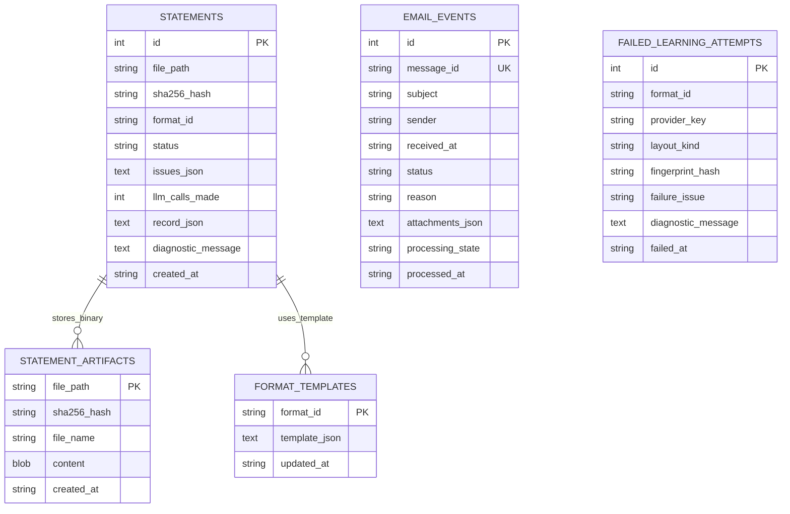

# STAGE 3: INGESTION, PERSISTENCE, CONSOLIDATION & DASHBOARD
## Activv Money — Self-Learning PMS/AIF Statement Parser
### Comprehensive Codebase Analysis & Technical Interview Guide for IIT Indore Candidates

---

# PART 9: LAYOUT DRIFT & HUMAN REVIEW WORKFLOW

### What is Layout Drift?
In wealth management, asset management companies frequently redesign their client statements. A provider like *Aurum PMS* may change a column header from `"Avg Cost"` to `"Cost Basis"`, add a new column, or adjust their table styling.
* If a parser blindly applies an old template, columns shift, numbers map to wrong fields (e.g. purchase price mapped to market value), and client books become corrupted.
* If the system automatically accepts any candidate template without human verification, a malformed statement could permanently corrupt the production template store.

### How Layout Drift is Detected in Code
In [`fingerprinter.py (lines 175–235)`](file:///d:/Desktop/StatementParser/fingerprinter.py#L175-L235):
1. **Header Similarity Match:** The engine computes sequence similarity between the document's headers and the registered template. If similarity is $\ge 0.75$, the document belongs to this provider.
2. **Column Presence Audit:** The fingerprinter checks if every column required by `template.holdings.mapping` exists in the document:
   ```python
   missing_cols = [col for col in required_cols if col not in document_headers]
   if missing_cols:
       is_drift = True
   ```
3. **Quarantine Isolation:** If `is_drift` is `True`, `pipeline.py` and `validator.py` assign the statement status `needs_review` and attach the issue label:
   > 🏷️ `layout_drift_known_provider` and `expected_column_missing:<column_name>`

### The Human-in-the-Loop Sign-Off & Promotion Workflow
1. A draft candidate template is created with `approved: false` (e.g. `aurum_pms_monthly_v2.json`).
2. The statement is quarantined into the **Durable Quarantine Store** (`statements.db`).
3. An operations manager opens **View 3 (Quarantined Review Queue)** in the Streamlit Dashboard.
4. The UI displays the detected schema diff and shows the button:
   `✅ Sign Off & Approve Template (Promote to Production)`.
5. Upon clicking:
   * `pipeline.approve_template(format_id)` flips `approved: true` and saves the updated JSON to `templates/`.
   * `reprocess_review_queue()` immediately re-evaluates all quarantined statements of this provider.
   * Subsequent statements parse deterministically with **0 LLM calls**!

---

# PART 10: EMAIL INGESTION & DOCUMENT HANDLING

### IMAP vs. SMTP Architecture
* **SMTP (Simple Mail Transfer Protocol):** Outbound sending protocol (`send_test_email.py`). Used to dispatch realistic statement emails to the mailbox over port 587 or 465.
* **IMAP (Internet Message Access Protocol):** Inbound retrieval protocol (`watch_mailbox.py`). Connects to `imap.gmail.com:993` with SSL to search for unread messages, inspect headers, and fetch attachments.

```
[SMTP Dispatcher (send_test_email.py)] ──(Sends via smtp.gmail.com:587)──> [Gmail Mailbox]
                                                                                │
[IMAP Worker (watch_mailbox.py)] <──(Polls UNSEEN via imap.gmail.com:993)──────┘
         │
         ├──> 3-Way Email Classifier (ingest / ignore / needs_review)
         ├──> Path-Sanitized Attachment Extraction (ingested_attachments/)
         ├──> PDF Preflight & Password Decryption
         └──> Pipeline Execution & Persistence
```

---

### The 3-Way Email Ingestion Gatekeeper
In [`ingestion.py (lines 145–225)`](file:///d:/Desktop/StatementParser/ingestion.py#L145-L225), `IngestionGatekeeper.preflight_email()` classifies emails into 3 categories:
1. **`ingest` (Process Immediately):**
   * Subject contains keywords: `statement`, `portfolio`, `pms`, `aif`, `valuation`, `quarterly`, `monthly`.
   * Contains valid statement attachment (`.pdf`, `.xlsx`, `.csv`).
2. **`ignore` (Discard Safely - 0ms Compute):**
   * Newsletters, marketing flyers, market commentaries, factsheets (`newsletter_with_factsheet`).
   * Portal link emails with zero attachments (`portal_link_no_attachment`).
   * Saves an audit event to `email_events` table with `status="ignore"`.
3. **`needs_review` (Quarantine):**
   * Email contains `.zip` archive (`zip_attachment_requires_manual_review`).
   * Unsupported file extension like `.xls` or `.xlsm` (`unsupported_statement_attachment_type`).
   * Ambiguous binary attachment (`ambiguous_attachment_requires_review`).

---

### Password-Protected PDF Decryption
Real-world HNI statements from banks are almost always password-protected.
In [`ingestion.py (lines 65–125)`](file:///d:/Desktop/StatementParser/ingestion.py#L65-L125):
1. **Detection:** Opens PDF with `pypdf.PdfReader`. Checks `reader.is_encrypted`.
2. **Decryption Strategy:**
   * Tries explicitly passed `password`.
   * Tries candidate passwords configured in `STATEMENT_PASSWORDS` in `.env` (e.g. `SecretPass123,ANANYA1985`).
   * Tries candidate client PANs.
3. **Decrypted Hash Deduplication:** Once decrypted, the raw decrypted bytes are written to a temporary decrypted file and hashed via SHA-256. This ensures that even if two copies of an encrypted PDF have different encryption salts, their decrypted content hash matches for 0ms deduplication!
4. **Interactive Dashboard Remediation:** If all candidate passwords fail, the file is quarantined with `password_required`. In View 3 of the dashboard, operators can type the password and click **🔓 Unlock & Process Statement** to decrypt, audit, and promote the statement live!

---

# PART 11: DATABASE AND PERSISTENCE ENGINE

### Dual-Engine Persistence (`persistence.py`)
The system implements a transparent, dual-database architecture:
* **Cloud Mode (Neon PostgreSQL):** Activated when `DATABASE_URL` is set in `.env` or Streamlit Secrets. Enables durable cloud persistence across web restarts.
* **Local Mode (SQLite `statements.db`):** Zero-config fallback with Write-Ahead Logging (`PRAGMA journal_mode=WAL;`) for high concurrency and zero setup.

---

### Relational Database Schema



### Table Breakdown:
1. **`statements`:** The master ledger of parsed statements. Stores `file_path`, `sha256_hash`, `status` (`validated`, `needs_review`, `duplicate`, `not_a_statement`), `issues_json`, `llm_calls_made`, and the full extracted JSON payload in `record_json`.
2. **`format_templates`:** Stores the declarative JSON templates so that runtime templates persist even across ephemeral container rebuilds.
3. **`statement_artifacts`:** Stores the raw binary file bytes (`BLOB`/`BYTEA`) so that uploaded files can be reprocessed without relying on local disk storage.
4. **`email_events`:** Logs every email processed by the IMAP watcher, enforcing unique `message_id` indexing to prevent duplicate email fetching.
5. **`failed_learning_attempts`:** Records failed LLM attempts by exact layout fingerprint hash, preventing infinite loops on broken layouts while allowing other layouts from the same provider to be learned.

---

# PART 12: PORTFOLIO CONSOLIDATION ENGINE

### Why Consolidation is Essential
HNIs distribute their wealth across multiple PMS and AIF providers (e.g. ₹5 Cr in Aurum Large Cap, ₹3 Cr in Banyan Mid Cap, ₹2 Cr in Evergreen Private Equity). 
* To make asset allocation decisions, wealth advisors need a **consolidated, cross-provider view** showing total equity, total cash, aggregate sector exposure, and top holdings across all accounts.

### How `consolidator.py` Works
In [`consolidator.py (lines 45–185)`](file:///d:/Desktop/StatementParser/consolidator.py#L45-L185):
1. **Client Identification by PAN:** Statements are grouped by client Permanent Account Number (`meta.pan`), which serves as the permanent legal identifier across all Indian financial institutions.
2. **ISIN Deduplication & Aggregation:** If Client A owns 500 shares of Reliance Industries (`INE002A01018`) in Aurum PMS and 300 shares of Reliance Industries in Banyan PMS:
   * The consolidator aggregates them into a single line item:
     $$\text{Total Quantity} = 500 + 300 = 800$$
     $$\text{Total Market Value} = \text{Value}_1 + \text{Value}_2$$
     $$\text{Blended Cost} = \frac{\text{Cost}_1 \times Q_1 + \text{Cost}_2 \times Q_2}{Q_1 + Q_2}$$
3. **Weight Re-normalization:** Calculates true holistic portfolio weight:
   $$\text{Consolidated Weight \%} = \left(\frac{\text{Aggregated Holding Value}}{\text{Total Consolidated Equity}}\right) \times 100$$
4. **Currency Isolation:** Portfolios are segmented by currency (`INR` vs `USD`). INR holdings and USD holdings are never naively added together without explicit currency conversion.
5. **Unlisted AIF Segregation:** Unlisted holdings (which lack ISINs and liquid market prices) are segregated into a distinct asset section so that private equity capital commitments do not distort liquid stock weights.

---

# PART 13: STREAMLIT DASHBOARD ARCHITECTURE

The web dashboard ([`app.py`](file:///d:/Desktop/StatementParser/app.py)) provides a 4-view operational interface:

```
Streamlit Web Dashboard (app.py)
├── Sidebar:
│   ├── Database Engine Badge (Neon PostgreSQL Cloud / SQLite local)
│   ├── Live Metric Counters: Learned Templates & DB Statement Records
│   ├── Reset Controls: Clean Templates (Cold Start) & Wipe Records
│   └── System Diagnostic Status (IMAP & Gemini Keys configured)
│
├── View 1: 📊 Ingested Statement Explorer
│   ├── Filter by Provider, Format, Status (Validated vs Needs Review)
│   ├── Statement Details: Metadata, Summary, Financial Rollforward metrics
│   ├── Interactive Holdings Table & Transaction Ledger
│   └── Download Raw Extracted JSON
│
├── View 2: 💼 Multi-Provider Portfolio Consolidation
│   ├── Select Client PAN & Name (Dynamic auto-discovery from DB)
│   ├── Select Reporting Period & Currency
│   ├── Executive Metrics: Total Corpus, Equity Value, Cash Balance, Active Accounts
│   ├── Aggregated Holdings Table with Re-normalized Weights
│   └── Multi-Account Provider Breakdown Cards
│
├── View 3: ⚠️ Quarantined Review Queue & Financial Safety Gate
│   ├── Durable SQLite/PostgreSQL Review Queue Table
│   ├── Human Auditor Template Sign-Off & Promotion (Layout Drift)
│   ├── Interactive Drift Demonstration Expander (10_aurum_v2_layout_drift.pdf)
│   ├── Encrypted Statement Password Unlock UI
│   └── Automated Financial Safety Gate Architecture Reference
│
└── View 4: 📤 Live Email Dispatch & Ingest
    ├── File Uploader (PDF, XLSX, CSV)
    ├── SMTP Live Dispatcher to IMAP_USER
    └── Real-Time IMAP Poller & Pipeline Execution Stream
```

---

# PART 14: COMPLETE DEPENDENCY & LIBRARY AUDIT

All production dependencies listed in [`requirements.txt`](file:///d:/Desktop/StatementParser/requirements.txt):

| Package Name | Exact Version | Purpose in Code | Files Using It | Why Appropriate & Alternatives |
|---|---|---|---|---|
| **`streamlit`** | `==1.65.0` | Front-end web dashboard & interactive review UI. | `app.py` | Fast, pure-Python UI; no Node.js/React build complexity needed. |
| **`pydantic`** | `==2.13.5` | Data contracts, schema validation, JSON schema gen. | `models.py`, `learner.py` | Rust-backed Pydantic v2 is 10x faster than dataclasses. |
| **`pdfplumber`** | `==0.11.10` | PDF table extraction, line geometry, text extraction. | `parser.py`, `fingerprinter.py` | Best-in-class bounding-box extraction; superior to PyPDF for tables. |
| **`pypdf`** | `==6.14.2` | PDF encryption detection and AES password decryption. | `ingestion.py` | Lightweight, robust crypto support; pure Python fallback. |
| **`cryptography`** | `==50.0.2` | Cryptographic primitives for AES-128/256 PDF decryption. | `ingestion.py` | Standard Python cryptographic library for encrypted PDFs. |
| **`pandas`** | `==3.0.0` | Tabular data manipulation and Streamlit dataframe display. | `app.py`, `consolidator.py` | Industry-standard vectorized tabular operations. |
| **`openpyxl`** | `==3.1.5` | Native parsing of modern `.xlsx` Excel statement workbooks. | `parser.py`, `ingestion.py` | Robust, zero-dependency Excel reader for multi-sheet portfolios. |
| **`requests`** | `==2.34.2` | HTTP client for Google Gemini API and external web calls. | `learner.py` | Stable, battle-tested HTTP library with timeout & backoff support. |
| **`imap-tools`** | `==1.15.1` | High-level IMAP client for connecting and parsing emails. | `watch_mailbox.py` | Clean MIME decoding, attachment handling, and UTF-8 header support. |
| **`psycopg2-binary`**| `==2.9.13`| PostgreSQL database adapter for Cloud Neon persistence. | `persistence.py` | High-performance C-extension driver for PostgreSQL. |

---

# PART 15: ENVIRONMENT VARIABLES & SECRETS AUDIT

All variables configured via [`.env.example`](file:///d:/Desktop/StatementParser/.env.example) and loaded into `os.environ`:

| Environment Variable | Purpose | Required / Optional | Consumed By | Default Behavior if Missing |
|---|---|:---:|---|---|
| **`GEMINI_API_KEY`** | Primary Google Gemini API key for one-shot learning. | Optional | `learner.py` | If missing, unseen formats quarantine to `learning_failed_llm_unavailable`. |
| **`GEMINI_BACKUP_API_KEY`** | Secondary Gemini key for automatic failover on 429 quota errors. | Optional | `learner.py` | If missing, system attempts primary key up to 2 times before quarantine. |
| **`LLM_MODEL`** | Model identifier for template synthesis. | Optional | `learner.py` | Defaults to `"gemini-3.8-flash"`. |
| **`IMAP_HOST`** | IMAP server address (e.g. `imap.gmail.com`). | Optional | `watch_mailbox.py` | Live mailbox polling disabled. |
| **`IMAP_PORT`** | IMAP server port (SSL). | Optional | `watch_mailbox.py` | Defaults to `993`. |
| **`IMAP_USER`** | Mailbox email address (Gmail address). | Optional | `watch_mailbox.py`, `send_test_email.py` | Live email ingestion disabled. |
| **`IMAP_PASSWORD`** | 16-character Google App Password. | Optional | `watch_mailbox.py`, `send_test_email.py` | Live email ingestion disabled. |
| **`IMAP_FOLDER`** | Mailbox folder to poll. | Optional | `watch_mailbox.py` | Defaults to `"INBOX"`. |
| **`STATEMENT_PASSWORDS`** | Comma-separated candidate passwords for locked PDFs. | Optional | `ingestion.py` | Encrypted statements quarantine with `password_required`. |
| **`DATABASE_URL`** | Neon PostgreSQL cloud connection string. | Optional | `persistence.py` | Defaults to local SQLite database (`statements.db`). |

---

### What Was Completed in Stage 3 & What Comes Next

* **Completed in Stage 3:**
  1. Detailed analysis of Layout Drift detection, isolation, and human sign-off promotion.
  2. Complete email ingestion architecture: IMAP poller, SMTP dispatcher, 3-way classifier, and password decryption.
  3. Relational database schema with ER diagram across SQLite and Neon PostgreSQL.
  4. Portfolio Consolidation engine: ISIN deduplication, weight re-normalization, and currency isolation.
  5. 4-View Streamlit dashboard walkthrough with state management and live controls.
  6. Comprehensive library audit across all production dependencies in `requirements.txt`.
  7. Environment variables and secrets audit.
* **Coming Next in Stage 4:**
  - **Part 16 & 17:** Automated Test Suites (`test_edge_cases.py`, `test_runner.py`), Security Audit, PII protection, and Financial Correctness.
  - **Part 18 & 19:** Failure Scenarios, Exception Handling, Performance Complexity, and Design Trade-offs.
  - **Part 20 & 21:** Mermaid Call Graphs and End-to-End Execution Traces on 3 representative statements.
  - **Part 22 & 23:** CLI / API Surface and Local vs. Cloud Deployment Guide.
